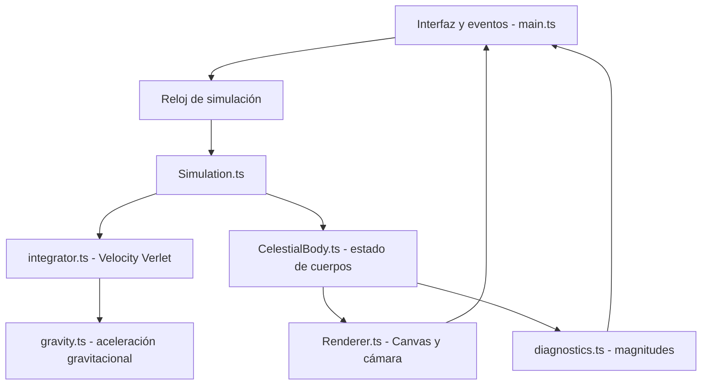

# Arquitectura del simulador

## Objetivo

Separar **modelo físico**, **estado de simulación**, **representación** e **interacción** para poder ampliar el simulador sin acoplarlo a una interfaz específica.

## Flujo general

## Responsabilidades

| Módulo | Función | No debería hacer |
|---|---|---|
| `physics/constants.ts` | Definir constantes en SI | Leer el DOM |
| `physics/gravity.ts` | Calcular aceleración entre cuerpos | Dibujar flechas |
| `physics/integrator.ts` | Actualizar posiciones y velocidades con paso fijo | Gestionar botones |
| `physics/diagnostics.ts` | Calcular distancia, rapidez relativa y energía | Modificar la escena |
| `simulation/CelestialBody.ts` | Declarar propiedades y vectores de un cuerpo | Ejecutar física por sí mismo |
| `simulation/Simulation.ts` | Configurar el sistema Tierra–Luna y actualizarlo | Manejar Canvas |
| `rendering/Renderer.ts` | Transformar coordenadas, renderizar, cámara, selección y trayectorias | Cambiar masas o fuerzas |
| `main.ts` | Componer módulos, eventos, panel y reloj | Reimplementar la gravedad |
| `style.css` | Diseño flotante y estados visuales | Calcular órbitas |

## Orden de actualización

1. Medir delta de tiempo real mediante `requestAnimationFrame`.
2. Acumular el tiempo físico según `timeScale`.
3. Ejecutar pasos fijos `physicsDt = 60 s` mediante Velocity Verlet.
4. Sincronizar la cámara con el cuerpo seguido si corresponde.
5. Renderizar cuerpos, trayectorias, rejilla, baricentro y vectores.
6. Actualizar los indicadores científicos.

## Coordenadas

- **Mundo:** metros, con +Y hacia arriba.
- **Pantalla:** píxeles CSS, con +Y hacia abajo.
- `worldToScreen`: centro de cámara y escala de metros/píxel.
- `screenToWorld`: transformación inversa usada para zoom al cursor.
- `pan`: cambia el centro de la cámara; no modifica posiciones físicas.

## Sistemas de referencia

- La escena inicial usa posiciones y velocidades baricéntricas.
- Seguir un cuerpo **solo traslada la cámara**.
- Las flechas de velocidad/aceleración pueden dibujarse relativas al cuerpo seguido restando sus vectores.
- El historial de trayectorias se guarda en coordenadas del mundo: no constituye una trayectoria relativa recalculada en cada instante.

## Convención documental

Aplicar TSDoc a las funciones, clases, interfaces y componentes relevantes. Describir unidades, invariantes, excepciones y límites del método; evitar comentar únicamente lo que ya dice el código.
